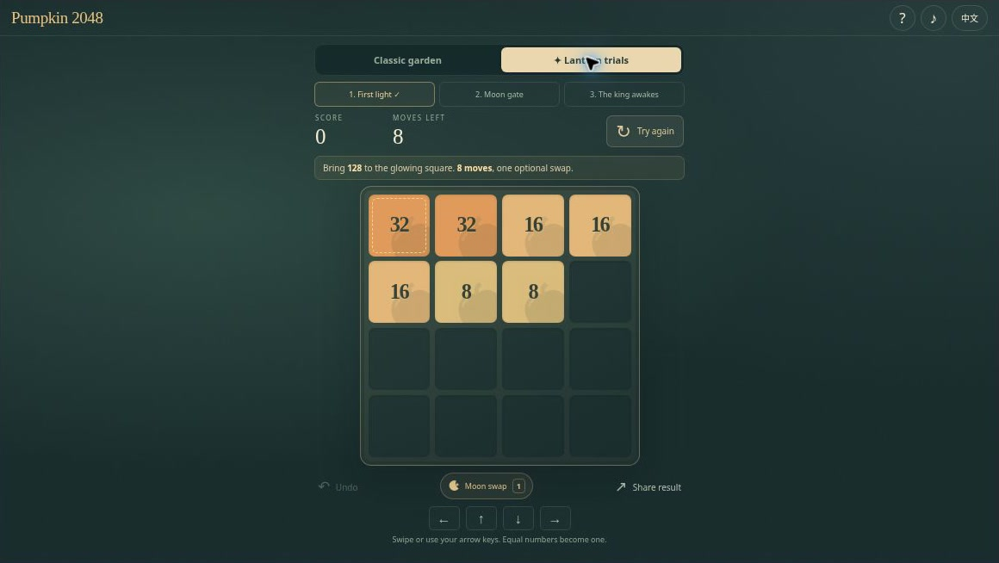
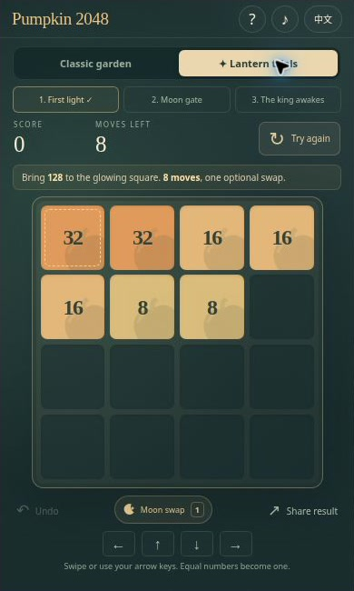

[English](README.md) · [简体中文](README.zh-CN.md) · [Español](README.es.md) · [Português (Brasil)](README.pt-BR.md) · [日本語](README.ja.md)

# Pumpkin 2048 — Puzzle de números de Halloween e desafios de lanternas

🎃 Deslize uma pequena abóbora, forme uma abóbora maior e acenda o jardim aos poucos. **Pumpkin 2048** leva o conhecido tabuleiro 4×4 para uma noite de Halloween. Busque um novo recorde no Classic Garden ou resolva uma Lantern Trial, em que a casa final importa tanto quanto o número criado.

**[Jogar agora](https://halloween-2048.crazy3d.org/)** · [Ver os 12 jogos de Halloween](https://github.com/AshinTop/halloween-games) · [⭐ Dar uma estrela no GitHub](https://github.com/AshinTop/halloween-2048)

O README está disponível em cinco idiomas. A **interface do jogo oferece apenas inglês e chinês simplificado**.



## O que torna este jogo especial

- **Classic Garden:** regras tradicionais de 2048, recorde local e continuação depois de alcançar 2048.
- **Três Lantern Trials:** posições iniciais fixas, uma casa-alvo e limite de movimentos, sem novas peças aleatórias durante o desafio.
- **Um Moon Swap por desafio:** troque duas peças ocupadas de valores diferentes gastando um movimento. Os três desafios também têm soluções verificadas sem o feitiço.
- Arte SVG original, lanternas ao atingir 128, 512, 1024 e 2048, sons sintetizados opcionais e respeito à preferência de movimento reduzido.
- Desfazer recupera tabuleiro, pontos, movimentos e disponibilidade do feitiço. Há controles de toque, mouse e teclado.

## Como jogar

No **Classic Garden**, deslize todas as peças em uma direção. Números iguais que se encontram são somados: dois 8 viram um 16. Uma peça recém-combinada não se junta outra vez no mesmo movimento. Uma jogada válida adiciona um 2 ou um 4; se o tabuleiro não muda, nenhuma peça aparece. Chegar a 2048 cumpre a meta e permite continuar. O tabuleiro cheio só encerra a partida quando não há mais jogada legal.

Nas **Lantern Trials**, leia a faixa do objetivo antes de começar. Forme o número indicado na casa iluminada dentro do limite de movimentos. Não surgem peças novas. Para usar Moon Swap, selecione o feitiço e duas peças com valores diferentes. Casas vazias e valores iguais não podem ser trocados. A troca gasta um movimento; desfazê-la também devolve o feitiço.

## Controles

| Ação | Como fazer |
| --- | --- |
| Deslizar | Setas do teclado, gesto de deslizar ou botões de direção |
| Desfazer | **U** ou Undo |
| Moon Swap | Selecionar o feitiço e duas peças de valores diferentes |
| Cancelar a seleção do feitiço | **Esc** |
| Recomeçar, ajuda e som | Botões do jogo; o teclado precisa de foco dentro do iframe |

## Um pouco de estratégia

Mantenha caminhos para aproximar números iguais, em vez de buscar toda combinação imediata. Nos desafios, observe primeiro a casa-alvo: um número grande no lugar errado não completa a tarefa. Moon Swap pode salvar um plano, mas ainda custa uma jogada. Use Desfazer para comparar duas rotas sem reiniciar a cada tentativa.

## Progresso e links de desafios

O progresso do Classic, as preferências e os recordes ficam no navegador quando o armazenamento está disponível. O histórico de Desfazer guarda até **50 movimentos** durante a sessão da página e não apaga um recorde já obtido. Experimente o [desafio 1](https://halloween-2048.crazy3d.org/?trial=1) ou altere o parâmetro para 2 ou 3. Compartilhar usa o resultado real e o link do desafio; uma partida incompleta não é anunciada como vitória. Se o compartilhamento ou a área de transferência estiverem indisponíveis, o texto pode ser copiado manualmente.

## Capturas de tela e vídeo de apresentação



Captura real em um iframe compacto. Ela mostra o layout em uma janela pequena, não um teste em celular físico.

[Player de vídeo e transcrição](https://halloween-2048.crazy3d.org/intro.html) · [Baixar o MP4](docs/media/intro.mp4)

A **apresentação de 24 segundos, sem áudio**, combina capturas reais e legendas. É um passeio visual, não uma partida gravada continuamente nem uma demonstração sonora.

## Perguntas frequentes

### Moon Swap também funciona no Classic Garden?

Não. O feitiço pertence às Lantern Trials, pode ser usado uma vez por desafio e consome uma das jogadas disponíveis.

### Os três desafios têm solução?

Sim. Todos têm soluções completas verificadas sem o feitiço. Isso não significa que qualquer sequência de movimentos dará certo.

### Posso continuar em outro aparelho?

Não existe sincronização por conta. Os dados pertencem ao navegador e à origem do site; bloquear o armazenamento não impede jogar.

## Executar localmente e incorporar

Inicie um servidor HTTP na raiz do repositório:

```sh
python3 -m http.server 4173
```

Abra **http://localhost:4173/**. Não é preciso compilar nem instalar dependências. Use HTTP: `file://` pode bloquear módulos JavaScript.

Execute as verificações incluídas com Node:

```sh
npm test
```

As verificações cobrem uma fusão por movimento, comandos sem efeito, geração determinística, derrotas, custo do feitiço, soluções completas e leitura segura de links e preferências. Elas não medem o desempenho de celulares físicos.

```html
<iframe src="https://halloween-2048.crazy3d.org/?embed=1"
  title="Pumpkin 2048"
  style="display:block;width:100%;height:654px;border:0"
  allow="fullscreen" allowfullscreen></iframe>
```

A referência de desktop é **1160×654 pixels CSS**. Também foram revisadas janelas de 390×650, 390×794 e 844×340. O tabuleiro usa o espaço real do iframe; ajuda e resultados podem rolar dentro dos próprios painéis.

Veja [EMBEDDING.md](EMBEDDING.md) para tamanho, armazenamento, foco e permissões. Meça a altura disponível após a barra do site principal.

## Mais pequenas aventuras de Halloween

- **[Pumpkin Shift](https://halloween-pumpkin-shift.crazy3d.org/)** · [Código](https://github.com/AshinTop/halloween-pumpkin-shift) — Deslize números por 12 salas com movimentos lunares limitados.
- **[Witch’s Candy Blocks](https://halloween-block-blast.crazy3d.org/)** · [Código](https://github.com/AshinTop/halloween-block-blast) — Encaixe doces em um tabuleiro 8×8 e complete pedidos de poções.
- **[Ghost Lanterns 3D](https://halloween-3d.crazy3d.org/)** · [Código](https://github.com/AshinTop/halloween-3d) — Ilumine um jardim de abóboras com regras de Lights Out e pares de almas.
- **[Trick-or-Treat TriPeaks](https://halloween-tripeaks.crazy3d.org/)** · [Código](https://github.com/AshinTop/halloween-tripeaks) — Encadeie cartas de valores consecutivos em oito resgates.

## Créditos e apoio

Criado para **AshinTop** e **Midnight Candy Club**, com design, programação e revisão conduzidos por pessoas com auxílio de IA. Arte e sons sintetizados originais do projeto. Dispensa conta remota; a hospedagem pode adicionar scripts ou registros de acesso.

Gostou? **[Deixe uma estrela no GitHub](https://github.com/AshinTop/halloween-2048)**. Para relatar problemas, inclua navegador, tamanho do iframe, link e passos para reproduzi-los.
